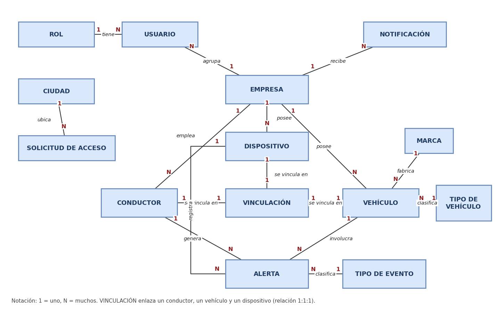
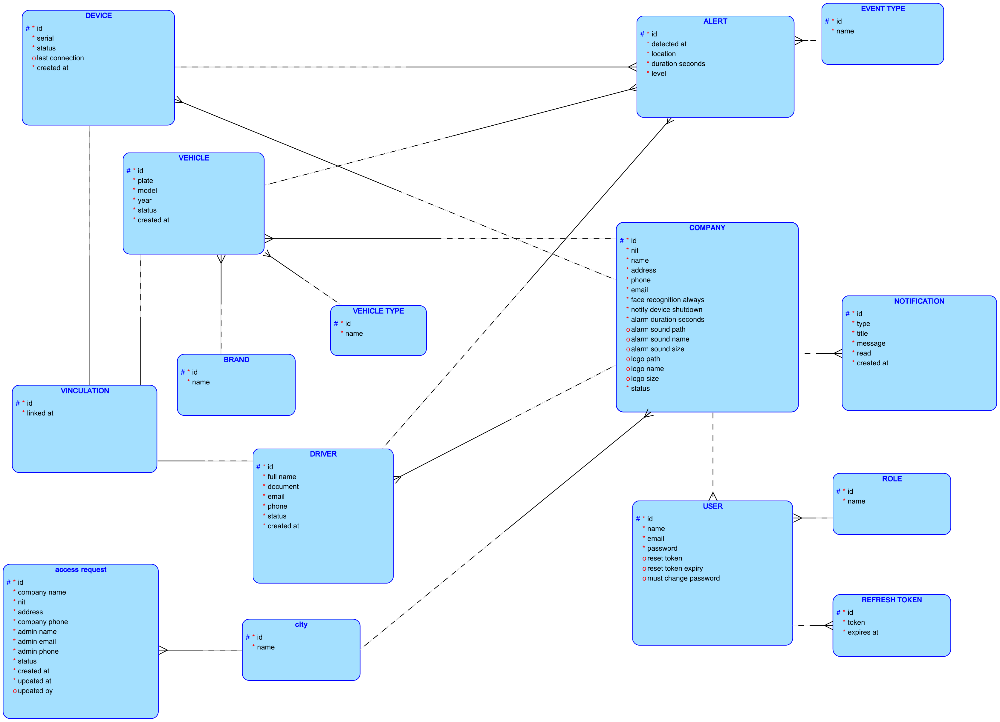
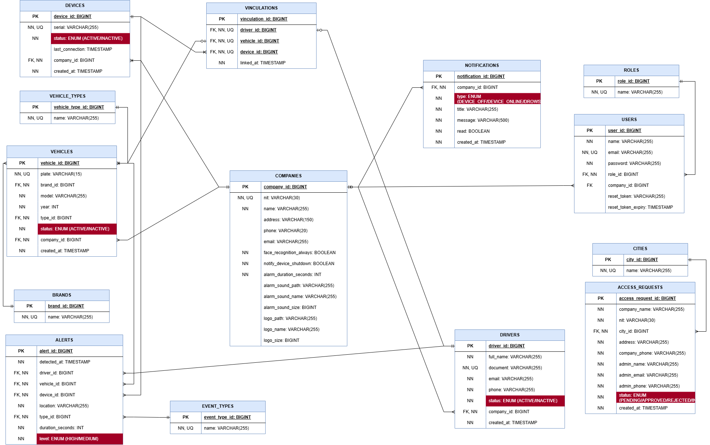
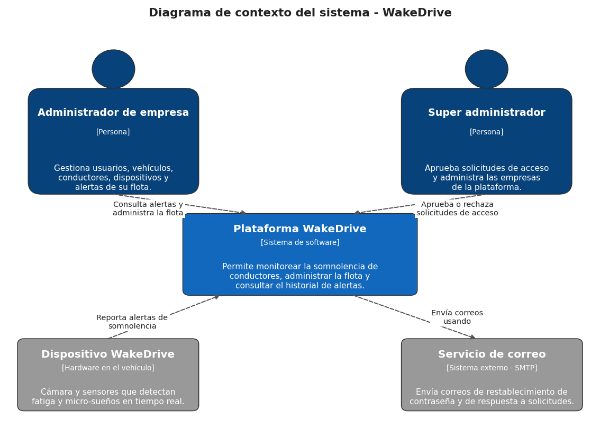
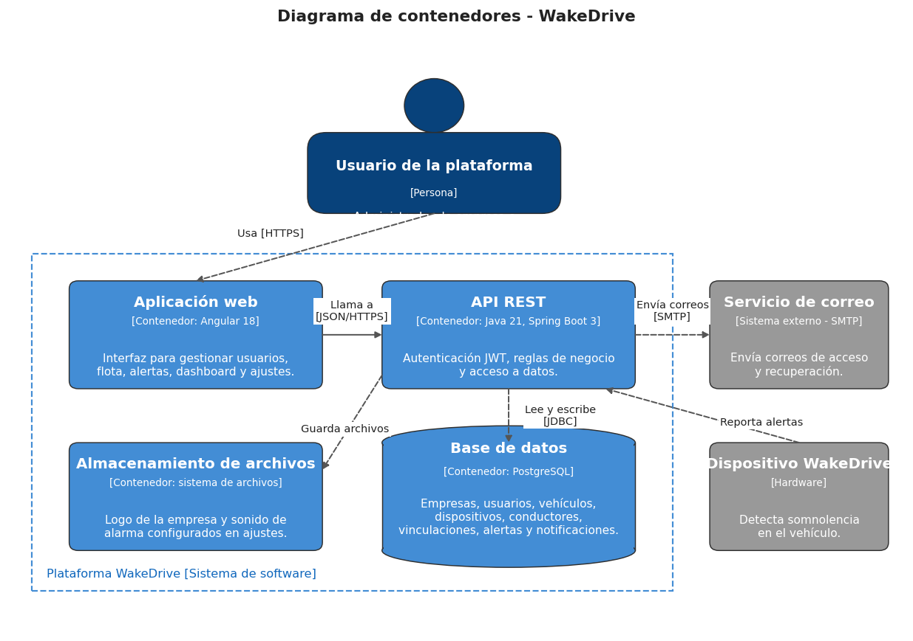

# wakedrive-database

Scripts y documentación de la base de datos de **WakeDrive** (PostgreSQL): plataforma de monitoreo de somnolencia de conductores. El documento completo del diseño está en el entregable *Documento de especificación del diseño e implementación de la Base de Datos*.

## Estructura del repositorio

```
wakedrive-database/
├── audit/
│   └── ddl/
│       ├── ddl_audi_users.sql
│       └── ddl_audi_vinculations.sql
├── ddl/
│   ├── ddl_access_requests.sql
│   ├── ddl_alerts.sql
│   ├── ddl_brands.sql
│   ├── ddl_cities.sql
│   ├── ddl_companies.sql
│   ├── ddl_devices.sql
│   ├── ddl_drivers.sql
│   ├── ddl_event_types.sql
│   ├── ddl_foreign_keys.sql
│   ├── ddl_notifications.sql
│   ├── ddl_refresh_token.sql
│   ├── ddl_roles.sql
│   ├── ddl_users.sql
│   ├── ddl_vehicle_types.sql
│   ├── ddl_vehicles.sql
│   └── ddl_vinculations.sql
├── docs/
│   ├── c4_nivel1_contexto.png
│   ├── c4_nivel2_contenedores.png
│   ├── modelo_conceptual.png
│   ├── modelo_fisico.png
│   └── modelo_logico.png
├── triggers/
│   └── trg_validate_alert.sql
├── .gitignore
└── README.md
```

| Contenido | Descripción |
|---|---|
| `docs/` | Diagramas del modelo (conceptual, lógico y físico) y de arquitectura (C4). |
| `ddl/` | Una tabla por archivo (15 tablas) y `ddl_foreign_keys.sql` con todas las claves foráneas. Reflejan el esquema que genera Hibernate en el backend. |
| `audit/ddl/` | Tablas `audi_<tabla>` de auditoría (2: users y vinculations). `audi_users` no guarda contraseñas ni tokens. |
| `triggers/` | `trg_validate_alert` (regla de negocio sobre alertas). |

## Modelos

### Modelo conceptual


### Modelo lógico


### Modelo físico


El diagrama físico refleja la base de datos implementada, con los tamaños definitivos de los atributos: las 15 tablas principales (incluida `refresh_token`, que guarda las sesiones de la API) y las tablas de auditoría `audi_users` y `audi_vinculations`.

### Arquitectura (modelo C4)




## Tablas principales

Convenciones: `pk` llave primaria, `uk` llave única, `fkN` llave foránea; opcionalidad `*` obligatorio y `o` opcional. Todas las claves foráneas impiden eliminar registros referenciados.

### Tabla 1. ROLES (RLS)

| Tipo de clave | Opcionalidad | Nombre de la columna | Tipo de dato | Tamaño | Referencia |
|---|---|---|---|---|---|
| pk | * | role_id | BIGINT |  |  |
| uk | * | name | VARCHAR | 50 |  |

Script: [`ddl/ddl_roles.sql`](ddl/ddl_roles.sql)

### Tabla 2. CITIES (CTY)

| Tipo de clave | Opcionalidad | Nombre de la columna | Tipo de dato | Tamaño | Referencia |
|---|---|---|---|---|---|
| pk | * | city_id | BIGINT |  |  |
| uk | * | name | VARCHAR | 50 |  |

Script: [`ddl/ddl_cities.sql`](ddl/ddl_cities.sql)

### Tabla 3. BRANDS (BRN)

| Tipo de clave | Opcionalidad | Nombre de la columna | Tipo de dato | Tamaño | Referencia |
|---|---|---|---|---|---|
| pk | * | brand_id | BIGINT |  |  |
| uk | * | name | VARCHAR | 50 |  |

Script: [`ddl/ddl_brands.sql`](ddl/ddl_brands.sql)

### Tabla 4. VEHICLE_TYPES (VTP)

| Tipo de clave | Opcionalidad | Nombre de la columna | Tipo de dato | Tamaño | Referencia |
|---|---|---|---|---|---|
| pk | * | vehicle_type_id | BIGINT |  |  |
| uk | * | name | VARCHAR | 50 |  |

Script: [`ddl/ddl_vehicle_types.sql`](ddl/ddl_vehicle_types.sql)

### Tabla 5. EVENT_TYPES (EVT)

| Tipo de clave | Opcionalidad | Nombre de la columna | Tipo de dato | Tamaño | Referencia |
|---|---|---|---|---|---|
| pk | * | event_type_id | BIGINT |  |  |
| uk | * | name | VARCHAR | 50 |  |

Script: [`ddl/ddl_event_types.sql`](ddl/ddl_event_types.sql)

### Tabla 6. COMPANIES (CMP)

| Tipo de clave | Opcionalidad | Nombre de la columna | Tipo de dato | Tamaño | Referencia |
|---|---|---|---|---|---|
| pk | * | company_id | BIGINT |  |  |
|  | * | alarm_duration_seconds | INTEGER |  |  |
|  | * | face_recognition_always | BOOLEAN |  |  |
|  | * | notify_device_shutdown | BOOLEAN |  |  |
|  | o | alarm_sound_size | BIGINT |  |  |
|  | o | logo_size | BIGINT |  |  |
|  | * | phone | VARCHAR | 10 |  |
| uk | * | nit | VARCHAR | 12 |  |
|  | * | email | VARCHAR | 100 |  |
|  | * | name | VARCHAR | 100 |  |
|  | * | address | VARCHAR | 150 |  |
|  | o | alarm_sound_name | VARCHAR | 255 |  |
|  | o | alarm_sound_path | VARCHAR | 255 |  |
|  | o | logo_name | VARCHAR | 255 |  |
|  | o | logo_path | VARCHAR | 255 |  |

Script: [`ddl/ddl_companies.sql`](ddl/ddl_companies.sql)

### Tabla 7. USERS (USR)

| Tipo de clave | Opcionalidad | Nombre de la columna | Tipo de dato | Tamaño | Referencia |
|---|---|---|---|---|---|
| pk | * | user_id | BIGINT |  |  |
|  | o | must_change_password | BOOLEAN |  |  |
| fk1 | o | company_id | BIGINT |  | companies(company_id) |
|  | o | reset_token_expiry | TIMESTAMP |  |  |
| fk2 | * | role_id | BIGINT |  | roles(role_id) |
| uk | * | email | VARCHAR | 100 |  |
|  | * | name | VARCHAR | 100 |  |
|  | * | password | VARCHAR | 255 |  |
|  | o | reset_token | VARCHAR | 255 |  |

Script: [`ddl/ddl_users.sql`](ddl/ddl_users.sql)

### Tabla 8. REFRESH_TOKEN (RFT)

| Tipo de clave | Opcionalidad | Nombre de la columna | Tipo de dato | Tamaño | Referencia |
|---|---|---|---|---|---|
| pk | * | id | BIGINT |  |  |
|  | * | expires_at | TIMESTAMP |  |  |
| fk1 | * | user_id | BIGINT |  | users(user_id) |
| uk | * | token | VARCHAR | 255 |  |

Script: [`ddl/ddl_refresh_token.sql`](ddl/ddl_refresh_token.sql)

### Tabla 9. ACCESS_REQUESTS (ARQ)

| Tipo de clave | Opcionalidad | Nombre de la columna | Tipo de dato | Tamaño | Referencia |
|---|---|---|---|---|---|
| pk | * | access_request_id | BIGINT |  |  |
| fk1 | * | city_id | BIGINT |  | cities(city_id) |
|  | * | created_at | TIMESTAMP |  |  |
|  | * | admin_phone | VARCHAR | 10 |  |
|  | * | company_phone | VARCHAR | 10 |  |
|  | * | nit | VARCHAR | 12 |  |
|  | * | status | VARCHAR | 20 |  |
|  | * | admin_email | VARCHAR | 100 |  |
|  | * | admin_name | VARCHAR | 100 |  |
|  | * | company_name | VARCHAR | 100 |  |
|  | * | address | VARCHAR | 150 |  |

Script: [`ddl/ddl_access_requests.sql`](ddl/ddl_access_requests.sql)

### Tabla 10. VEHICLES (VHC)

| Tipo de clave | Opcionalidad | Nombre de la columna | Tipo de dato | Tamaño | Referencia |
|---|---|---|---|---|---|
| pk | * | vehicle_id | BIGINT |  |  |
|  | * | year | INTEGER |  |  |
| uk | * | plate | VARCHAR | 6 |  |
| fk1 | * | brand_id | BIGINT |  | brands(brand_id) |
| fk2 | * | company_id | BIGINT |  | companies(company_id) |
|  | * | created_at | TIMESTAMP |  |  |
| fk3 | * | vehicle_type_id | BIGINT |  | vehicle_types(vehicle_type_id) |
|  | * | status | VARCHAR | 20 |  |
|  | * | model | VARCHAR | 50 |  |

Script: [`ddl/ddl_vehicles.sql`](ddl/ddl_vehicles.sql)

### Tabla 11. DEVICES (DVC)

| Tipo de clave | Opcionalidad | Nombre de la columna | Tipo de dato | Tamaño | Referencia |
|---|---|---|---|---|---|
| pk | * | device_id | BIGINT |  |  |
| fk1 | * | company_id | BIGINT |  | companies(company_id) |
|  | * | created_at | TIMESTAMP |  |  |
|  | o | last_connection | TIMESTAMP |  |  |
|  | * | status | VARCHAR | 20 |  |
| uk | * | serial | VARCHAR | 50 |  |

Script: [`ddl/ddl_devices.sql`](ddl/ddl_devices.sql)

### Tabla 12. DRIVERS (DRV)

| Tipo de clave | Opcionalidad | Nombre de la columna | Tipo de dato | Tamaño | Referencia |
|---|---|---|---|---|---|
| pk | * | driver_id | BIGINT |  |  |
| fk1 | * | company_id | BIGINT |  | companies(company_id) |
|  | * | created_at | TIMESTAMP |  |  |
| uk | * | document | VARCHAR | 10 |  |
|  | o | phone | VARCHAR | 10 |  |
|  | * | status | VARCHAR | 20 |  |
|  | o | email | VARCHAR | 100 |  |
|  | * | full_name | VARCHAR | 100 |  |

Script: [`ddl/ddl_drivers.sql`](ddl/ddl_drivers.sql)

### Tabla 13. VINCULATIONS (VNC)

| Tipo de clave | Opcionalidad | Nombre de la columna | Tipo de dato | Tamaño | Referencia |
|---|---|---|---|---|---|
| pk | * | vinculation_id | BIGINT |  |  |
| uk, fk1 | * | device_id | BIGINT |  | devices(device_id) |
| uk, fk2 | * | driver_id | BIGINT |  | drivers(driver_id) |
|  | * | linked_at | TIMESTAMP |  |  |
| uk, fk3 | * | vehicle_id | BIGINT |  | vehicles(vehicle_id) |

Script: [`ddl/ddl_vinculations.sql`](ddl/ddl_vinculations.sql)

### Tabla 14. ALERTS (ALR)

| Tipo de clave | Opcionalidad | Nombre de la columna | Tipo de dato | Tamaño | Referencia |
|---|---|---|---|---|---|
| pk | * | alert_id | BIGINT |  |  |
|  | * | duration_seconds | INTEGER |  |  |
|  | * | detected_at | TIMESTAMP |  |  |
| fk1 | * | device_id | BIGINT |  | devices(device_id) |
| fk2 | * | driver_id | BIGINT |  | drivers(driver_id) |
| fk3 | * | event_type_id | BIGINT |  | event_types(event_type_id) |
| fk4 | * | vehicle_id | BIGINT |  | vehicles(vehicle_id) |
|  | * | level | VARCHAR | 10 |  |
|  | * | location | VARCHAR | 150 |  |

Script: [`ddl/ddl_alerts.sql`](ddl/ddl_alerts.sql)

### Tabla 15. NOTIFICATIONS (NTF)

| Tipo de clave | Opcionalidad | Nombre de la columna | Tipo de dato | Tamaño | Referencia |
|---|---|---|---|---|---|
| pk | * | notification_id | BIGINT |  |  |
|  | * | read | BOOLEAN |  |  |
| fk1 | * | company_id | BIGINT |  | companies(company_id) |
|  | * | created_at | TIMESTAMP |  |  |
|  | * | type | VARCHAR | 30 |  |
|  | * | title | VARCHAR | 100 |  |
|  | * | message | VARCHAR | 255 |  |

Script: [`ddl/ddl_notifications.sql`](ddl/ddl_notifications.sql)

## Auditoría

Cada tabla de auditoría (`audi_<tabla>`) está pensada para guardar el estado de la fila antes (`state = OLD`) y después (`state = NEW`) de un INSERT, UPDATE o DELETE: un INSERT deja una fila NEW, un DELETE deja una fila OLD y un UPDATE deja una de cada una. `audi_users` no tiene las columnas `password`, `reset_token` ni `reset_token_expiry`, para no guardar secretos.

### Tabla 16. AUDI_<TABLA> (estructura común)

| Tipo de clave | Opcionalidad | Nombre de la columna | Tipo de dato | Tamaño |
|---|---|---|---|---|
| pk | * | audit_id | BIGINT |  |
|  | * | operation | VARCHAR | 10 |
|  | * | state | CHAR | 3 |
|  | * | changed_by | VARCHAR | 100 |
|  | * | changed_at | TIMESTAMP |  |
|  | o | (columnas de la tabla auditada) | las mismas | las mismas |

| Tabla auditada | Tabla de auditoría | Script |
|---|---|---|
| users | audi_users | [`ddl`](audit/ddl/ddl_audi_users.sql) |
| vinculations | audi_vinculations | [`ddl`](audit/ddl/ddl_audi_vinculations.sql) |

## Triggers de negocio

| Trigger | Regla | Script |
|---|---|---|
| `trg_validate_alert` | Solo un dispositivo ACTIVE, vinculado al mismo conductor y vehículo, puede registrar alertas. | [`triggers/trg_validate_alert.sql`](triggers/trg_validate_alert.sql) |

## Integrantes

Mariana Barbosa Torrado, Euder Julian Pacheco Ascanio y Hannah Cabarico Salazar. Universidad Francisco de Paula Santander Ocaña, Bases de datos relacionales.
